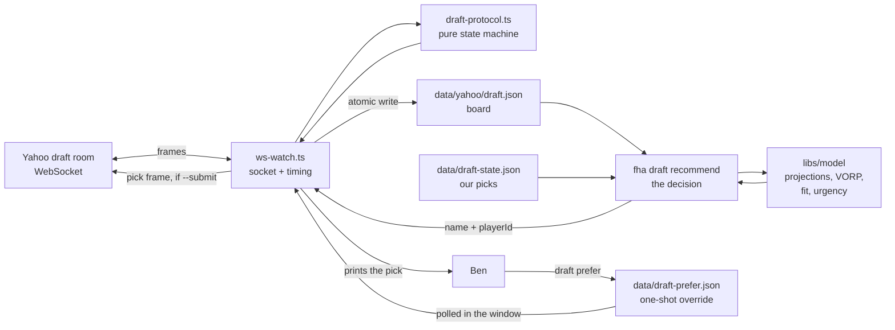
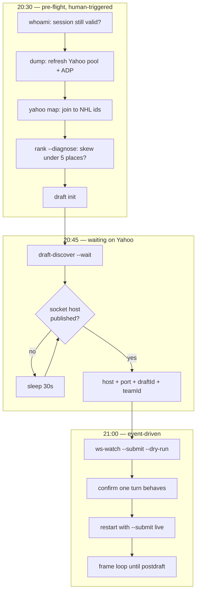
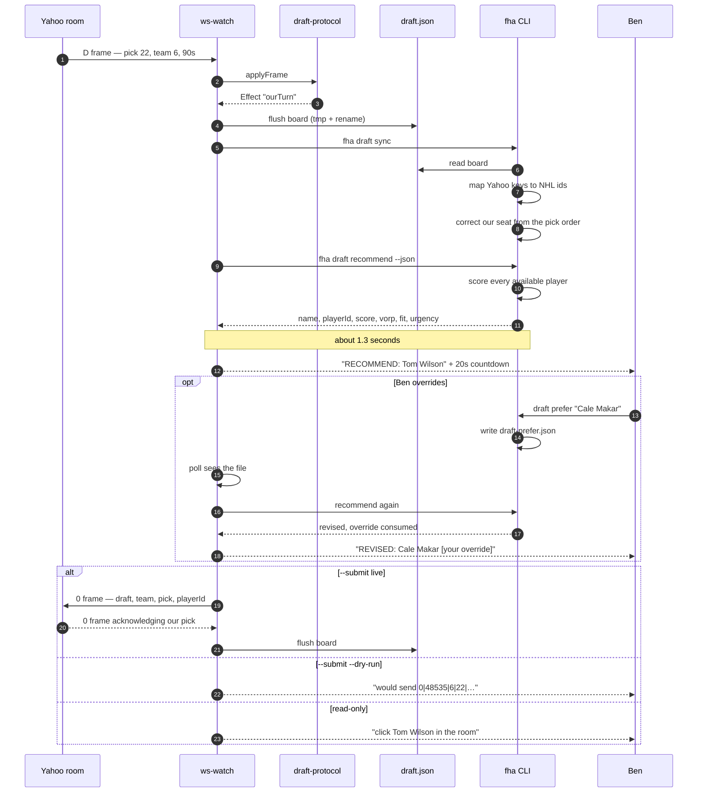
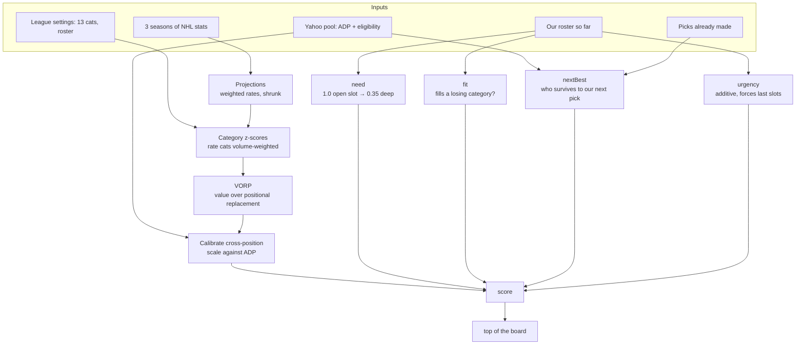
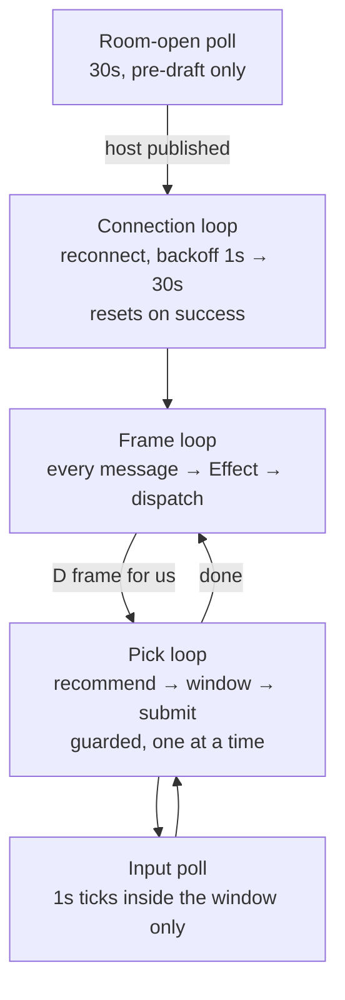
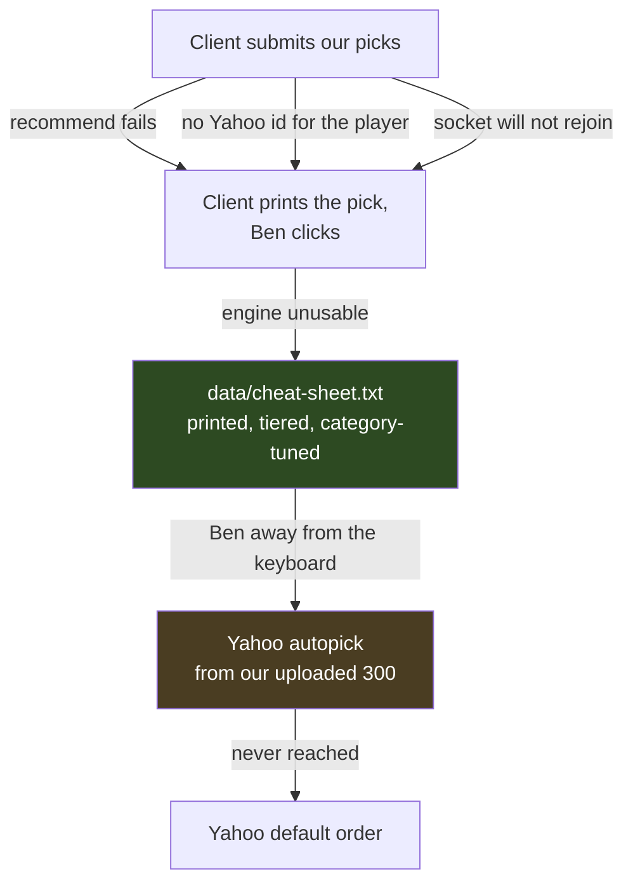

# How tonight actually works

A walkthrough of the triggers, loops and decision paths for the 2026-09-24 draft.
Operating instructions live in [`DRAFT-NIGHT.md`](./DRAFT-NIGHT.md); this explains the machinery.

---

## 1. The cast

Five pieces, each owning exactly one thing.

| Piece | Where | Owns |
|---|---|---|
| **Yahoo draft room** | `wss://…sports-aws-prod-omega…` | Truth. Who is on the clock, who has been taken. |
| **`ws-watch.ts`** | `prototypes/yahoo-web/tools/` | The socket. Holds the session, decides *when* to act. |
| **`draft-protocol.ts`** | same | Pure interpretation. Turns a frame into an `Effect`. No I/O. |
| **`data/yahoo/draft.json`** | repo | The bridge. Board state, written atomically. |
| **`fha` CLI** | `apps/gm` | The brain. Valuation, scoring, the recommendation. |

They are split this way for one reason: **the socket needs a credential, the brain needs
tests.** Keeping them in separate processes joined by a file means the valuation stays in the
tested workspace and the credential stays out of it.



---

## 2. The night, end to end

Three phases with different trigger types: **clock-driven** before the draft, **event-driven**
once it starts.



**Why dry-run first:** a headless pick has been proven twice, but never in *this* room. The
dry-run exercises the entire decision path and logs the exact frame without sending it, so the
only untested thing left at go-live is the send itself.

---

## 3. Triggers

Nothing polls the draft. Everything is a reaction to a frame, with two exceptions.

| Trigger | Type | Reaction |
|---|---|---|
| `H` header | frame | Record seconds per pick |
| `R` pick order | frame | **Derive our seat** from where our team id sits |
| `P` board replay | frame | Rebuild the entire board in one shot |
| `D` on the clock | frame | If it is us → **the pick loop** (§4). If not → flush board |
| `0` pick made | frame | Record it, flush board |
| `5` autopick on | frame | If us → it was forced by a missed pick; turn it back off |
| `X` rejection | frame | Log the code. Board is stale; it re-syncs next turn |
| socket close | event | Reconnect with backoff |
| `draft prefer` | **file** | Polled once a second, but only inside the input window |
| room not open | **clock** | 30-second poll, pre-draft only |

The `R` frame trigger matters more than it looks. It removes a question nobody had a reliable
answer to: our seat. A seat entered by hand that disagrees with Yahoo's real order would
silently corrupt every scarcity and urgency number, because both depend on *when our next pick
comes*. `draft sync` now derives the seat and corrects a mismatched config value.

---

## 4. One of our picks, in detail

This is the critical path. Everything else exists to make this work.



**The input window is bounded so it can never cost us the pick:**

```
window = min(configured, floor(clock / 2) − 5)
```

On a 90-second clock with the default 20s setting that is 20 seconds to intervene and ~70
seconds of slack. On a 12-second clock it collapses to 1 second, and below that it is skipped
with a note. A pick missed while waiting for input would be strictly worse than a pick made
without it.

---

## 5. How the recommendation is reached

`fha draft recommend` scores every available player and returns the top one. Four terms, each
answering a different question.



```
score = need × (VORP + fit) + 0.5 × (VORP + fit − nextBest) + urgency
```

| Term | Question it answers | Why it exists |
|---|---|---|
| **VORP** | How much better than a replacement starter at his position? | Positional scarcity |
| **fit** | Does he help a category we are *losing*? | A H2H category is **won, not accumulated**. Without this the board piled up +17 in hits while losing assists |
| **need** | Would he fill a starting slot, or a third bench body? | Stops a 5th centre outranking a needed defenceman |
| **nextBest** | Will someone comparable still be there at our next pick? | Take the scarce one now, the deep one later |
| **urgency** | Are we about to run out of picks with slots unfilled? | An empty starting slot is a zero in four categories *every day* |

`urgency` is **additive, not multiplicative**, and that is deliberate. The first version
multiplied — which inverted in exactly the situation it was written for, because by round 17
every remaining player has negative VORP and multiplying a negative by a boost makes it worse.

---

## 6. The loops



Two guards keep the pick loop honest:

- **`submitted` set** — a repeated `D` frame for a pick we already sent cannot double-send.
- **`handling` flag** — only one turn is processed at a time, so a frame arriving mid-decision
  cannot start a second, racing decision.

---

## 7. When things go wrong

The design principle is a **ladder**: each rung degrades to the one below, and the bottom rung
is paper.



| Failure | What happens | Why it is survivable |
|---|---|---|
| Recommendation errors or times out | Logs, prints **PICK BY HAND**, socket stays up | The failure cannot take the connection down with it |
| Socket drops | Reconnects; the `P` replay rebuilds the **whole** board on rejoin | Rejoining is idempotent — no state is lost in a disconnect |
| Pick rejected (`X 29`) | Logged; board was stale | Re-syncs on the next turn; pick by hand now |
| Clock expires | Yahoo autopicks **from our uploaded rankings**, then forces autopick on | This is why the 300 were uploaded; it is the real safety net |
| Session expires | `YahooAuthError`; nothing silently half-works | Re-login on the PC, copy the file across |
| Everything fails | The cheat sheet is on disk and on paper | Category-tuned rankings beat Yahoo's default order |

---

## 8. What is still unproven

Stated plainly, because these are the places tonight could still surprise us.

- **A headless pick in *this* room.** Proven twice in mocks with the browser disconnected.
  Never against league 48535. Hence dry-run first.
- **Two connections for one team.** If `ws-watch` is connected, do not also leave a browser
  draft room open for team 6. Nobody has tested what Yahoo does with both.
- **The room token.** League rooms appear to need none — the room URL returned 200 without one
  and a public mock joined with an empty token. Confirm when the room opens.
- **The projection is backward-looking.** It under-rates young ascending players; it has
  Celebrini and Kaprizov well below consensus. That is what the input window is for.
- **Two draftable prospects are deliberately unranked** — Gavin McKenna (ADP 94) and Ivar
  Stenberg (ADP 135) have no NHL games, so there is nothing to project. They will not appear on
  the board at all.
